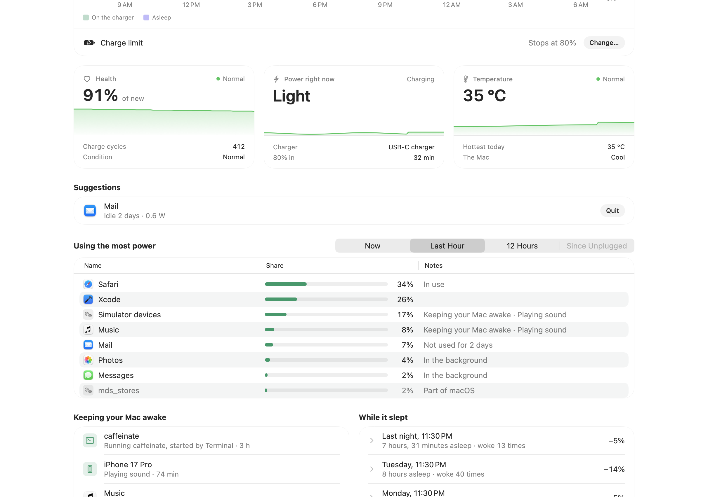
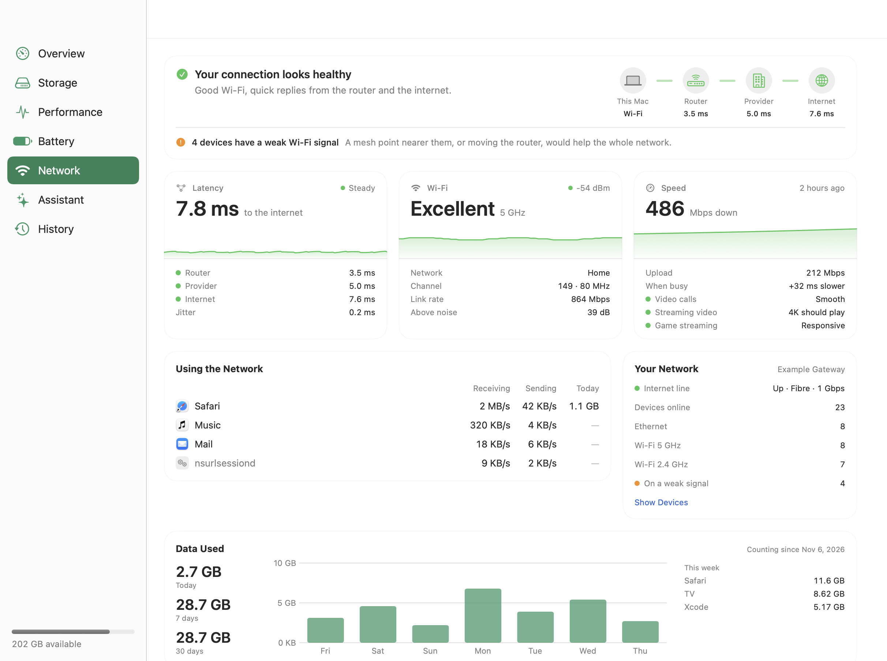

# Glade

Glade shows what is using your Mac's storage, memory, processors, graphics, battery and network, and clears it safely. It knows where caches, build data, simulators, package downloads, AI models and agent history pile up, says how each one comes back if removed, and never goes near your keys, mail, photos or cloud folders. Your own AI (Claude Code, Codex and others) can help it decide, and coding agents can drive it from the command line.


Glade needs macOS 26 or later. It is free and open source.

## Install

1. Download the DMG from the [latest release](https://github.com/dlev02/Glade/releases/latest).
2. Drag Glade to Applications.
3. Open it.

Glade checks for updates once a day and installs an update the next time it quits. Turn this off in Settings.

## First run

Setup opens by itself the first time, and again from **Help > Set Up Glade…**.

1. **Full Disk Access.** macOS keeps some folders from every app until you allow it. Without it Glade still works, but it can't measure everything and says what it skipped. The button in setup opens the right pane of System Settings; turn Glade on there.
2. **Notifications.** Glade tells you when free space runs low, memory is under pressure or something keeps the processor busy for minutes. Allow them when asked.
3. **An AI, if you want one.** Glade asks an AI command-line tool you already use, signed in with your own account. Install and sign in to [Claude Code](https://claude.com/claude-code) or [Codex](https://developers.openai.com/codex), or turn on Apple Intelligence, and Glade finds it. Everything else works without one.
4. **Open at login.** On by default for a copy in Applications, so the menu bar item and alerts are there after a restart. Switch it off in setup or in Settings.
5. **Command line tool, if you want it.** **Install** links the `glade` command into `~/.local/bin`.

## Use

The window has six sections: **Overview**, **Storage**, **Performance**, **Battery**, **Assistant** and **History**. Glade also lives in the menu bar, so closing the window leaves it running.

### Storage


**Scan Now** (Command-R) measures the known locations and lists what can go, by category. **Scan Including Duplicates** (Shift-Command-R) also looks for identical files in your own folders, which takes longer. A scan reads names, sizes and dates; it changes nothing.

Every finding says how it comes back:

| | |
| --- | --- |
| Rebuilds itself | Caches, build data, logs. The app or tool makes them again when needed. |
| Downloads again | Package caches, AI models, simulator runtimes. Fetched again the next time they're used. |
| Needs reinstall | Toolkits, SDKs, editor extensions. |
| Can't be undone | Nothing recreates it once it's gone. Your own files always go to the Trash first. |

### Three levels

| Level | Selects |
| --- | --- |
| Careful | Only things that rebuild themselves and haven't been touched lately: Xcode build data and test simulators after 3 days, a project's build folders after a week. |
| Balanced | Waits half as long for those (a day, and 3 days for build folders), and adds package caches, stale agent sessions (14 days and older), idle simulators and AI models. |
| Aggressive | Everything that can come back, even if it was used recently. |

The level picks a starting selection. Change any item by hand before you clean. Each of Xcode's test and preview simulators is listed on its own, so the ones Xcode used today stay while older ones go. When a bolder level would free a lot more, `glade plan` says how much and what it would add. An older version of a test browser goes after three days once a newer version beside it is the one being used.

To free only some rows, highlight them (Shift- or Command-click), then right-click and choose **Free Up…** or press Delete; what is ticked elsewhere stays as it was.

### Apps

**Apps** in Storage lists every app in your Applications folders, big and long-unused ones first, with when each was last opened and where it came from. The inspector shows what goes with an app (its settings, caches and data in your home folder, each with its size) and what stays and why, such as a folder another app from the same developer shares. Apps are never ticked for you at any level. Uninstalling moves the app and its data to the Trash, so **Put Back** brings everything back.

Some apps, Adobe's above all, put parts across the system that only their own uninstaller removes. For those Glade shows **Open Uninstaller** instead of a tick box; scan again afterwards and App Leftovers lists anything it left. Apps that belong to the system account, which includes most App Store apps, need your password to move, and Glade never asks for it: **Show in Finder** takes you there to drag it to the Trash. Glade itself and macOS's own apps aren't listed.

On Overview, **Other** opens a list of everything else on the disk, folder by folder: your home folder, apps, macOS and its downloads, system data. It reads names and sizes only and never measures protected folders. A folder in your Library that belongs to an app says whose it is, or that no installed app uses it. Right-click a row, or use the button that appears when you point at it, to **Move to Trash…** (when it's yours to remove; otherwise the menu says why not), **Uninstall…** an app, or **Show in Storage**. This works in the window only: there is no command for it, so an agent can never name a folder for Glade to remove.

### What Glade never touches

This is the part to read.

- **Protected areas are invisible.** SSH, GPG and cloud credentials, `.env` and key files, Keychains and password managers, your AI agents' memory, skills, settings and sign-ins, Photos, Music and other media libraries, Messages and Mail, Notes, Contacts, Calendars and Health, iCloud Drive, Dropbox, Google Drive and OneDrive, browser profiles, Time Machine and other backups, endpoint security, VPN and device management software, and every `.git` folder. Glade never scans, lists or removes them, and never shows them to an AI. `glade protect check <path>` explains why any path is off limits, and you can add folders of your own.
- **Only findings can be removed.** Cleaning takes the identifiers of things a scan found, never a path. Before removing anything, Glade checks every path against the protected areas again, refuses anything outside your home and temporary folders or on another disk, follows no link out of where it may work, and won't remove a repository whole. The one thing outside your home folder it may move is an app you chose to uninstall, and only a real app (not a link) directly in an Applications folder or one folder down, on the same disk, that isn't open, isn't part of macOS and isn't Glade.
- **Personal files are never chosen for you.** Anything in Desktop, Documents, Downloads, Movies, Music, Pictures, Public or Sites, and anything permanent, is only removed when you pick it.
- **Cleaning can be undone where it matters.** Things that rebuild or download again are deleted. Everything else goes to the Trash, and **Put Back** in History (or `glade undo`) returns it to where it was. Space held in the Trash is only freed when you empty it, so Glade counts it separately from space it frees.
- **Apps in use are left alone.** A cache isn't offered while its app is open, a toolkit, runtime or app version that a running program was started from isn't removed, an agent's worktree with uncommitted changes is never removed, and a scan older than 12 hours must be redone before cleaning from it. Both checks are made again at the moment of removal.

### Performance


Glade lists apps with their helper processes grouped, and what each is doing: in front, playing audio, using the microphone, keeping the Mac awake, idle for hours. It suggests what to quit and why, never the app in front, anything playing or recording, anything holding the Mac awake or anything busy right now. Quitting asks the app politely, as its Quit menu item would, so it can ask about unsaved work. Booted simulators are listed with the memory they hold, and idle ones can be shut down with their apps and data kept.

**Free Up Memory** does it all in one go, the way a clean does for storage: it lists every app it would quit and simulator it would shut down, with what each holds and any doubt, ticks only the ones it's confident nobody is using, and leaves anything you used in the last few minutes, and anything that goes with a game or full-screen video in front, for you to tick. Afterwards it shows what happened to each and memory in use before and after, as measured; an app asking about unsaved work stays open and is reported. The memory pressure alert says how much it would give back, and clicking the alert opens it.

### Battery



The charge with one sentence saying what it's doing ("Charging to 80%, there in 25 min", "On battery, about 5 hours left"), and a chart of the last day, week or month with time on the charger and asleep marked. Health is the same "Maximum Capacity" System Settings shows. **Using the most power** lists apps by the energy macOS counted against them, now, in the last hour, the last 12 hours or since you unplugged, with notes such as "keeping your Mac awake" or "not used for 2 days", and quits them from the row. **Keeping your Mac awake** names each app, simulator or tool holding off sleep, what it's doing and for how long, crediting sound a simulator plays to that simulator rather than to macOS's audio service. **While it slept** shows each recent sleep with the charge it cost and why the Mac woke by itself.

The charge limit you set in System Settings › Battery shows here too. Glade can't change it: macOS only takes a new limit from System Settings, so **Change…** opens that pane. Glade records the charge every five minutes while it's open, on your Mac only; the energy figures cover the processor and neural engine, not the screen or graphics chip. **Settings > General > Battery detail** switches to Technical for milliamp-hours, watts, volts and cycles, and **Alerts** has six battery alerts: charged past the limit, limit turned off, hot while charging, health below 80%, kept awake on battery and a heavy drain while asleep. On a Mac without a battery the section is **Energy** and shows what applies.

### Network



Whether your connection is healthy and, if not, where the trouble is: your Wi-Fi, your internet line or further out. Glade pings your router, your provider's first router and the internet once a second while the section is open and draws each one, so a slow hop shows where it is; a spike lines up with the app that was busiest at the time. **Wi-Fi** shows the signal, band, channel and link rate. **Test Speed** runs macOS's own speed test when you ask, and says how much slower the line gets when it's busy (what makes calls stutter during uploads) and whether it's good for calls, 4K and game streaming. **Using the Network** lists apps by what they're sending and receiving, and Performance gains a Network column. On an AT&T gateway, **Your Network** reads the line and lists the devices on your network with their signal, without a password. You can add its Device Access Code, which Glade checks by signing in and keeps in your Keychain, ready for changing the gateway's settings from Glade. **Data Used** counts what this Mac used each day, by app and by network, while Glade is open. To tell your networks apart by name, macOS asks for Location access the first time; everything else works without it.

If you use Little Snitch, export a backup from it (File › Create Backup) and import it on Network. Glade lists what stands out: rules that let any app reach any server, duplicates, conflicts, rules for apps you've removed. **Review with Assistant** explains them and suggests changes, with new rules as a file you import into Little Snitch as a group that starts switched off. Glade never reads or changes Little Snitch itself.

### Assistant


Ask a question ("why is my Mac slow right now?") or have your AI refine a clean towards a goal ("free 30 GB"). The AI gets no tools: it can't see files, run commands or remove anything. It answers with the identifiers of findings, and Glade drops any suggestion that breaks the rules above, such as selecting a personal file or going past the level you chose. **History** keeps exactly what was sent and what came back.

Ask it to remove something by name ("remove the Adobe apps", "uninstall iMovie") and the answer comes with a list of the matching apps and items, each with the AI's reason. A second AI looks the list over first and notes anything you should know, such as a subscription that keeps billing or files only that app opens. Only what you named starts ticked, and only if Glade can remove it: apps with their own uninstaller get **Open Uninstaller**, ones that need your password **Show in Finder**, and open ones say to quit them first. **Review and Remove…** opens the usual confirmation, and everything goes to the Trash, so **Put Back** undoes it. For this, the AI is shown the names, sizes and last-opened dates of the apps that match your request (see [PRIVACY.md](PRIVACY.md)).

| AI | Status |
| --- | --- |
| Claude Code, Codex, OpenCode | Tested |
| Apple Intelligence (on this Mac) | Tested |
| Gemini CLI, Cursor CLI, GitHub Copilot CLI, Qwen Code, Ollama | Written from their documentation; not yet tested |

It follows the conversation, so "and the other one?" makes sense, and it remembers what you choose: when an answer learns something lasting (your internet provider, a problem that keeps coming back) it offers **Remember**, and your notes go with every question after that. They're listed in **Settings > Assistant**, where you can add, change or remove them. Rules work in code, not in a prompt: under **Settings > Protection > Always clear**, an app you no longer use has its leftovers and caches ticked at every level and sent to the Trash.

Each tool runs in an empty temporary folder with its own tools, plugins, MCP servers and memory switched off. Apple Intelligence and Ollama run on your Mac; the others send the request to their provider under your account.

### Menu bar


A leaf in the menu bar shows memory pressure at a glance, and can show free space beside it. On battery, the menu bar window adds one line with the time left and the biggest drain; otherwise only an app that has kept the Mac awake for hours earns that line. Overview has a battery tile beside memory, processor and graphics.

## Command line and agents

The app's executable is also the `glade` command. **Install** in setup, or in **Settings > Advanced**, links it into `~/.local/bin`. By hand:

```sh
ln -s /Applications/Glade.app/Contents/MacOS/Glade ~/.local/bin/glade
```

**Settings > Advanced** also connects Claude Code and Codex to Glade's MCP server with one click, and shows the exact command it runs.

Every command accepts `--json`, and nothing is removed without `--confirm`.

| Command | What it does |
| --- | --- |
| `glade scan` | What's reclaimable, by category. Changes nothing. |
| `glade usage` | Everything on the disk, folder by folder, biggest first. Changes nothing. |
| `glade plan --level careful` | What that level would remove. Changes nothing. |
| `glade clean --level careful` | A dry run; add `--confirm` to remove. Also `--ids <id>…` for chosen findings. |
| `glade installed` | Every app with its size, when it was last opened, where it came from and whether it has its own uninstaller. `--unused <days>`, `--sort size\|opened`. |
| `glade uninstall "<app>"` | A dry run of what goes to the Trash and what stays; add `--confirm` to do it, or `--open-uninstaller` for apps with their own. |
| `glade ask "<question>"` | Ask your AI about this Mac. Asked to remove something ("uninstall iMovie"), it lists what matches with a second opinion and the dry-run commands to act on it; it never removes anything itself. |
| `glade undo` | Put back what the last clean moved to the Trash. |
| `glade status`, `glade apps`, `glade suggest` | Processor, memory, graphics and disk; what each app is doing; what to quit. |
| `glade relieve` | Free Up Memory: what Glade would quit and shut down in one go, and what it ticks. Add `--confirm` to do it; `--include`/`--exclude` change the ticks. |
| `glade quit "<app>"` | Ask an app to quit. |
| `glade battery`, `glade battery history` | Charge, health, power, temperature, charge limit and estimates; what was recorded day by day. |
| `glade energy --period hour` | Apps by energy: `now`, `hour`, `12h` or `unplugged`. |
| `glade awake`, `glade sleeps` | What is keeping the Mac awake; recent sleeps with the charge they cost and what woke the Mac. |
| `glade network` | Is the connection healthy, and if not, where's the problem: your Wi-Fi, your internet line or further out? With the Wi-Fi signal, latency to the router, your provider and the internet, and the apps using the network. |
| `glade network watch --for 30` | Latency second by second, with what was busiest at each spike. |
| `glade network usage --period week --by app` | Data used by day, app or network, recorded while the app is open. |
| `glade network check <site>` | Is one service slow, or your connection? Compares it with apple.com. |
| `glade network router` | What your router reports (AT&T gateways): the line, its speed and the devices on your network. |
| `glade network test` | Says what a speed test would use; add `--confirm` to run macOS's own test. |
| `glade notes`, `glade rules` | What the Assistant remembers; apps whose leftovers are always cleared. `add` and `remove` change them. |
| `glade protect check <path>` | Why a path is or isn't off limits. |
| `glade doctor` | Permissions and what Glade can't see; when space is low, what a clean would free. |
| `glade show storage` | Open the window on overview, storage, performance, battery, network, assistant or history. |

Run `glade --help` for the rest.

### Claude Code, Codex, Cursor and other agents

Agents don't need `rm`, `du` or `kill`: Glade does the measuring and removing, inside its rules. `glade guide` prints a briefing written for agents: the safety model, the commands, and how to judge what to quit. Ask your agent to read it first.

Glade is also an MCP server, with tools to scan, plan, clean (a dry run unless confirmed), undo and check a path:

```sh
claude mcp add glade -- glade mcp
codex mcp add glade -- glade mcp
```

For Cursor, add it to `~/.cursor/mcp.json`:

```json
{ "mcpServers": { "glade": { "command": "/Applications/Glade.app/Contents/MacOS/Glade", "args": ["mcp"] } } }
```

macOS gives Full Disk Access to the app a command is started from, not to Glade. To let the command line and MCP server measure everything, allow your terminal (or the agent's app) too. `glade doctor` shows whether it has it.

## Privacy

Glade has no account, analytics or server, and never sends what's inside your files. Apart from the daily update check to GitHub, what leaves your Mac is what you ask a cloud AI, which goes to that AI's provider under your own account, and the network checks you start: pings to your router, your provider and one internet host (1.1.1.1 unless you change it), and a speed test against Apple's servers only when you ask for one. [PRIVACY.md](PRIVACY.md) lists exactly what each one sends.

## Report a problem

**Help > Report a Problem…** (or `glade report`) saves a report to your Desktop: versions, settings, what kinds of things the last scan found and recent log lines, with file names left out. Read it, then attach it to a [new issue](https://github.com/dlev02/Glade/issues/new). Glade sends nothing itself. For a security problem, follow [SECURITY.md](SECURITY.md).

## Build from source

Open `Glade.xcodeproj` in Xcode or Bitrig and run the Glade scheme, or from the command line:

```sh
xcodebuild -project Glade.xcodeproj -scheme Glade build
```

The engine, interface and command line are a Swift package in `Packages/GladeKit` that builds and tests on its own:

```sh
cd Packages/GladeKit
swift build
swift test
.build/debug/glade --help
```

Sparkle (for updates) and Swift Argument Parser are the only dependencies, and Swift Package Manager fetches them. A copy run from outside an Applications folder never checks for updates. Only one copy of the app runs at a time, so quit the installed one before opening the one you built.

See [CONTRIBUTING.md](CONTRIBUTING.md) before changing anything that removes files.

## Licence

Glade is licensed under the [GNU General Public License, version 3](LICENSE). Copyright 2026 Drew Levinson. See [NOTICE](NOTICE) for third-party acknowledgements.
