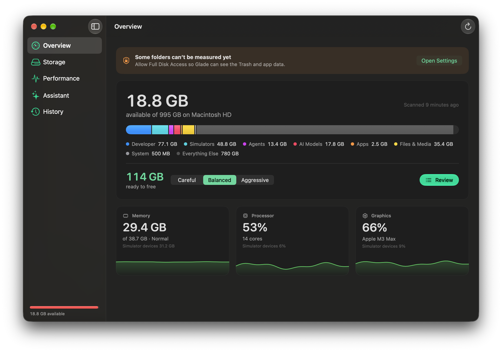
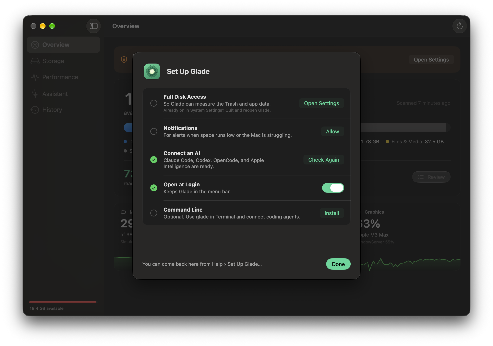
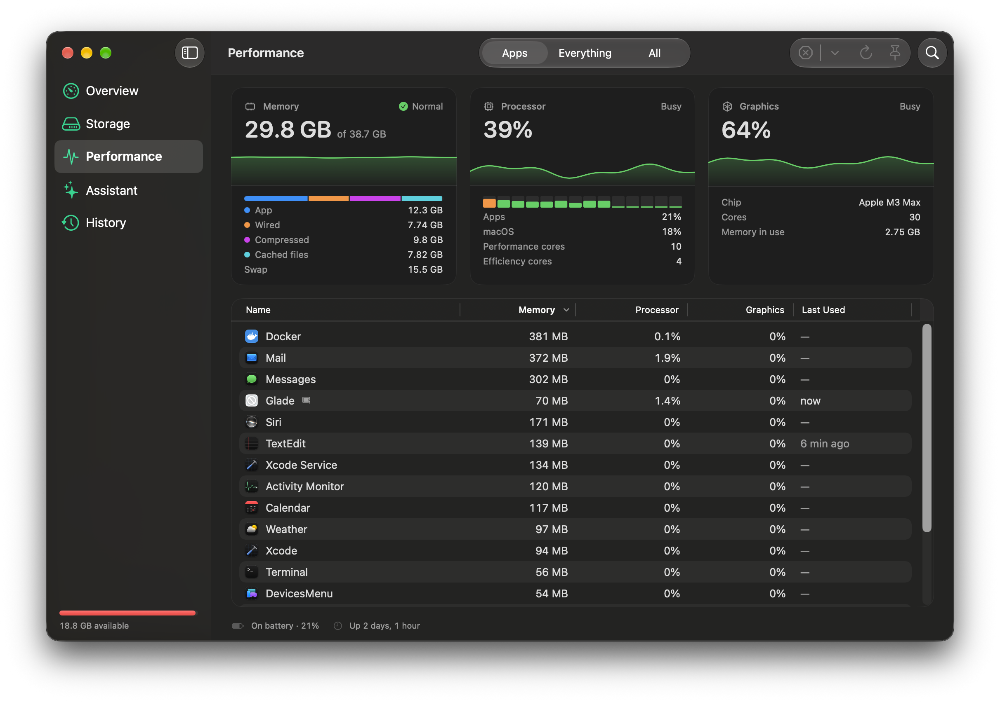
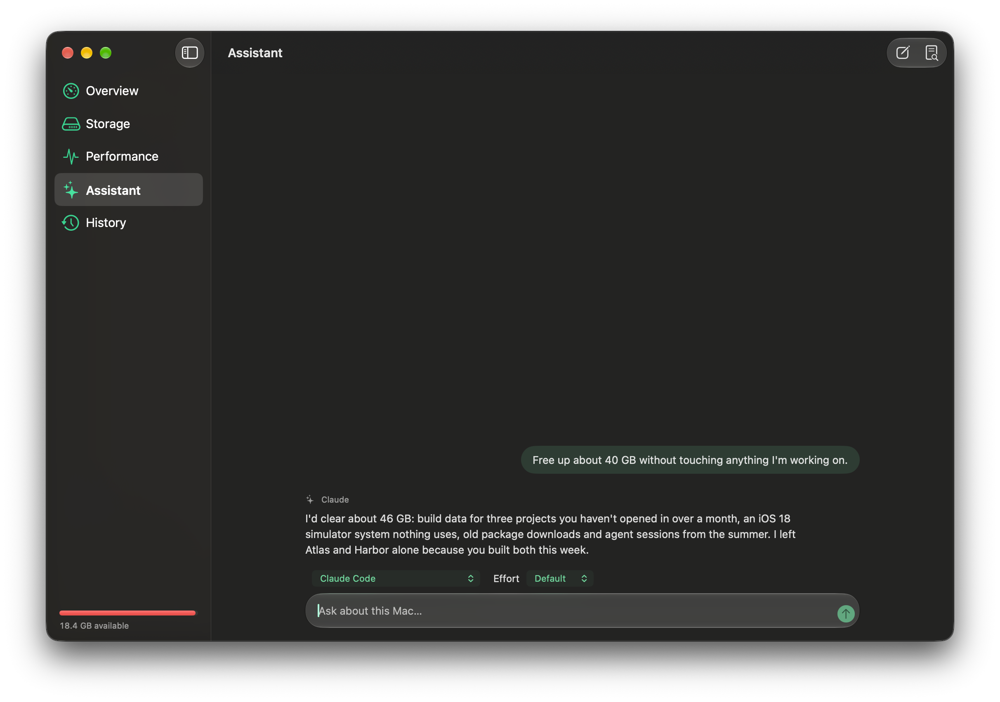
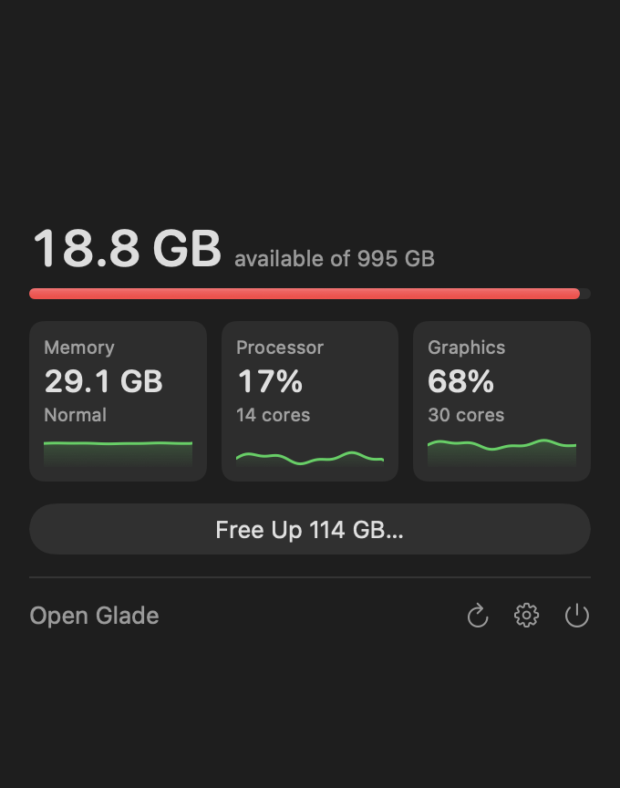

# Glade

Glade shows what is using your Mac's storage, memory, processors and graphics, and clears it safely. It knows where caches, build data, simulators, package downloads, AI models and agent history pile up, says how each one comes back if removed, and never goes near your keys, mail, photos or cloud folders. Your own AI (Claude Code, Codex and others) can help it decide, and coding agents can drive it from the command line.



Glade needs macOS 26 or later. It is free and open source.

## Install

1. Download the DMG from the [latest release](https://github.com/dlev02/Glade/releases/latest).
2. Drag Glade to Applications.
3. Open it.

Glade checks for updates once a day and installs an update the next time it quits. Turn this off in Settings.

## First run

Setup opens by itself the first time, and again from **Help > Set Up Glade…**.

1. **Full Disk Access.** macOS keeps some folders from every app until you allow it. Without it Glade still works, but it can't measure everything and says what it skipped. The button in setup opens the right pane of System Settings; turn Glade on there.
2. **Notifications.** Glade tells you when free space runs low, memory is under pressure or something keeps the processor busy for minutes. Allow them when asked.
3. **An AI, if you want one.** Glade asks an AI command-line tool you already use, signed in with your own account. Install and sign in to [Claude Code](https://claude.com/claude-code) or [Codex](https://developers.openai.com/codex), or turn on Apple Intelligence, and Glade finds it. Everything else works without one.
4. **Open at Login.** On by default for a copy in Applications, so the menu bar item and alerts are there after a restart. Switch it off in setup or in Settings.
5. **Command line, if you want it.** **Install** links the `glade` command into `~/.local/bin`.

## Use

The window has five sections: **Overview**, **Storage**, **Performance**, **Assistant** and **History**. Glade also lives in the menu bar, so closing the window leaves it running.

### Storage



**Scan Now** (Command-R) measures the known locations and lists what can go, by category. **Scan Including Duplicates** (Shift-Command-R) also looks for identical files in your own folders, which takes longer. A scan reads names, sizes and dates; it changes nothing.

Every finding says how it comes back:

| | |
| --- | --- |
| Rebuilds itself | Caches, build data, logs. The app or tool makes them again when needed. |
| Downloads again | Package caches, AI models, simulator runtimes. Fetched again the next time they're used. |
| Reinstall to restore | Toolkits, SDKs, editor extensions. |
| Permanent | Gone for good once emptied from the Trash, so only you can choose it. |

### Three levels

| Level | Selects |
| --- | --- |
| Careful | Only things that rebuild themselves and haven't been touched lately. |
| Balanced | Adds package caches, stale agent sessions (14 days and older), idle simulators and AI models. |
| Aggressive | Everything that can come back, even if it was used recently. |

The level picks a starting selection. Change any item by hand before you clean.

### What Glade never touches

This is the part to read.

- **Protected areas are invisible.** SSH, GPG and cloud credentials, `.env` and key files, Keychains and password managers, your AI agents' memory, skills, settings and sign-ins, Photos, Music and other media libraries, Messages and Mail, Notes, Contacts, Calendars and Health, iCloud Drive, Dropbox, Google Drive and OneDrive, browser profiles, Time Machine and other backups, endpoint security, VPN and device management software, and every `.git` folder. Glade never scans, lists or removes them, and never shows them to an AI. `glade protect check <path>` explains why any path is off limits, and you can add folders of your own.
- **Only findings can be removed.** Cleaning takes the identifiers of things a scan found, never a path. Before removing anything, Glade checks every path against the protected areas again, refuses anything outside your home and temporary folders or on another disk, follows no link out of where it may work, and won't remove a repository whole.
- **Personal files are never chosen for you.** Anything in Desktop, Documents, Downloads, Movies, Music, Pictures, Public or Sites, and anything permanent, is only removed when you pick it.
- **Cleaning can be undone where it matters.** Things that rebuild or download again are deleted. Everything else goes to the Trash, and **Put Back** in History (or `glade undo`) returns it to where it was.
- **Apps in use are left alone.** A cache isn't offered while its app is open, a toolkit, runtime or app version that a running program was started from isn't removed, an agent's worktree with uncommitted changes is never removed, and a scan older than 12 hours must be redone before cleaning from it. Both checks are made again at the moment of removal.

### Performance



Glade lists apps with their helper processes grouped, and what each is doing: in front, playing audio, using the microphone, keeping the Mac awake, idle for hours. It suggests what to quit and why, never the app in front, anything playing or recording, anything holding the Mac awake or anything busy right now. Quitting asks the app politely, as its Quit menu item would, so it can ask about unsaved work. Booted simulators are listed with the memory they hold, and idle ones can be shut down with their apps and data kept.

### Assistant



Ask a question ("why is my Mac slow right now?") or have your AI refine a clean towards a goal ("free 30 GB"). The AI gets no tools: it can't see files, run commands or remove anything. It answers with the identifiers of findings, and Glade drops any suggestion that breaks the rules above, such as selecting a personal file or going past the level you chose. **History** keeps exactly what was sent and what came back.

| AI | Status |
| --- | --- |
| Claude Code, Codex, OpenCode | Tested |
| Apple Intelligence (on this Mac) | Tested |
| Gemini CLI, Cursor CLI, GitHub Copilot CLI, Qwen Code, Ollama | Written from their documentation; not yet tested |

Each tool runs in an empty temporary folder with its own tools, plugins, MCP servers and memory switched off. Apple Intelligence and Ollama run on your Mac; the others send the request to their provider under your account.

### Menu bar



A leaf in the menu bar shows memory pressure at a glance, and can show free space beside it.

## Command line and agents

The app's executable is also the `glade` command. **Install** in setup, or in **Settings > Advanced**, links it into `~/.local/bin`. By hand:

```sh
ln -s /Applications/Glade.app/Contents/MacOS/Glade ~/.local/bin/glade
```

**Settings > Advanced** also connects Claude Code and Codex to Glade's MCP server with one click, and shows the exact command it runs.

Every command accepts `--json`, and nothing is removed without `--confirm`.

| Command | What it does |
| --- | --- |
| `glade scan` | What's reclaimable, by category. Changes nothing. |
| `glade plan --level careful` | What that level would remove. Changes nothing. |
| `glade clean --level careful` | A dry run; add `--confirm` to remove. Also `--ids <id>…` for chosen findings. |
| `glade undo` | Put back what the last clean moved to the Trash. |
| `glade status`, `glade apps`, `glade suggest` | Processor, memory, graphics and disk; what each app is doing; what to quit. |
| `glade quit "<app>"` | Ask an app to quit. |
| `glade protect check <path>` | Why a path is or isn't off limits. |
| `glade doctor` | Permissions and what Glade can't see. |
| `glade show storage` | Open the window on overview, storage, performance, assistant or history. |

Run `glade --help` for the rest.

### Claude Code, Codex, Cursor and other agents

Agents don't need `rm`, `du` or `kill`: Glade does the measuring and removing, inside its rules. `glade guide` prints a briefing written for agents: the safety model, the commands, and how to judge what to quit. Ask your agent to read it first.

Glade is also an MCP server, with tools to scan, plan, clean (a dry run unless confirmed), undo and check a path:

```sh
claude mcp add glade -- glade mcp
codex mcp add glade -- glade mcp
```

For Cursor, add it to `~/.cursor/mcp.json`:

```json
{ "mcpServers": { "glade": { "command": "/Applications/Glade.app/Contents/MacOS/Glade", "args": ["mcp"] } } }
```

macOS gives Full Disk Access to the app a command is started from, not to Glade. To let the command line and MCP server measure everything, allow your terminal (or the agent's app) too. `glade doctor` shows whether it has it.

## Privacy

Glade has no account, analytics or server, and never sends what's inside your files. Apart from the daily update check to GitHub, the only thing that leaves your Mac is what you ask a cloud AI, which goes to that AI's provider under your own account; [PRIVACY.md](PRIVACY.md) lists exactly what it is shown.

## Report a problem

**Help > Report a Problem…** (or `glade report`) saves a report to your Desktop: versions, settings, what kinds of things the last scan found and recent log lines, with file names left out. Read it, then attach it to a [new issue](https://github.com/dlev02/Glade/issues/new). Glade sends nothing itself. For a security problem, follow [SECURITY.md](SECURITY.md).

## Build from source

Open `Glade.xcodeproj` in Xcode or Bitrig and run the Glade scheme, or from the command line:

```sh
xcodebuild -project Glade.xcodeproj -scheme Glade build
```

The engine, interface and command line are a Swift package in `Packages/GladeKit` that builds and tests on its own:

```sh
cd Packages/GladeKit
swift build
swift test
.build/debug/glade --help
```

Sparkle (for updates) and Swift Argument Parser are the only dependencies, and Swift Package Manager fetches them. A copy run from outside an Applications folder never checks for updates. Only one copy of the app runs at a time, so quit the installed one before opening the one you built.

See [CONTRIBUTING.md](CONTRIBUTING.md) before changing anything that removes files.

## Licence

Glade is licensed under the [GNU General Public License, version 3](LICENSE). Copyright 2026 Drew Levinson. See [NOTICE](NOTICE) for third-party acknowledgements.
